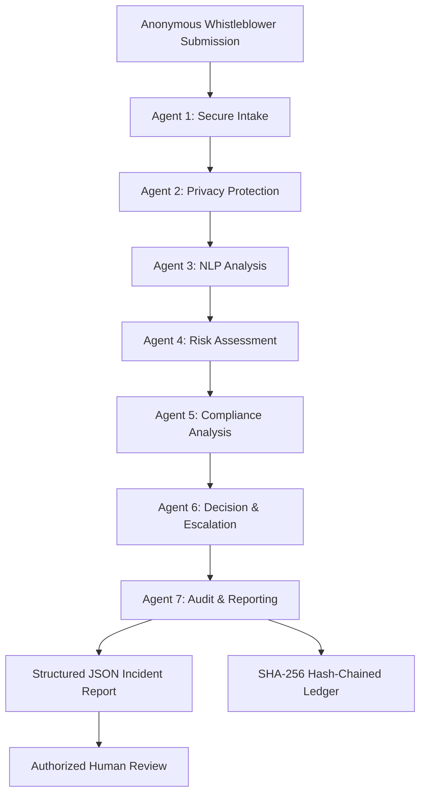

# 🛡️ WhistleGuard AI
### Autonomous Agentic AI for Whistleblower Leak Detection

<p align="center">
  **Detect. Protect. Analyze. Escalate.**
</p>

<p align="center">
  
</p>

<p align="center">
  
  
  
  
  
  
</p>

<p align="center">
  <i>A privacy-first, seven-agent intelligent compliance system designed to detect corporate misconduct, protect whistleblower identities, and accelerate ethical investigations.</i>
</p>

---

## 🌐 01. Project Overview

**WhistleGuard AI** is an autonomous multi-agent corporate compliance platform that transforms unstructured whistleblower disclosures into structured, privacy-protected, risk-classified incident reports.

Traditional whistleblower systems often expose employees to identity leaks, retaliation, subjective reviews, and delayed investigations.

WhistleGuard AI addresses these challenges through seven specialized AI agents that collaborate to:

- Securely process whistleblower submissions.
- Detect and redact Personally Identifiable Information (PII).
- Identify potential corporate misconduct using NLP.
- Calculate preliminary risk scores from 0–100.
- Map incidents to relevant regulatory frameworks.
- Automatically prioritize compliance escalation.
- Maintain tamper-evident SHA-256 audit records.

**Core Philosophy:** Protect the reporter. Preserve the evidence. Prioritize the truth.

---

## 🚨 02. The Problem We're Solving

Corporate compliance systems face four major challenges:

| Challenge | Existing Problem |
|---|---|
| Identity Exposure | Personal information may be visible during initial reviews. |
| Delayed Investigation | Critical reports can remain in general queues. |
| Institutional Bias | Manual triage may produce inconsistent assessments. |
| Audit Manipulation | Traditional logs may be modified without detectable evidence. |

### 💡 Our Solution

WhistleGuard AI introduces a privacy-preserving autonomous triage pipeline that analyzes disclosures, identifies potential ethical violations, and routes incidents to authorized human reviewers.

The platform prioritizes objective assessment without automatically determining guilt or imposing disciplinary action.

---

## ✨ 03. Key Features

| Feature | Description |
|---|---|
| 🔐 Secure Intake | Generates unique incident IDs and sanitizes submissions. |
| 🛡️ PII Protection | Detects and masks sensitive personal information. |
| 🧠 Hybrid NLP | Supports online LLM analysis and offline heuristic processing. |
| 🎯 Risk Intelligence | Assigns preliminary severity scores between 0 and 100. |
| ⚖️ Compliance Mapping | Identifies potentially relevant legal and policy frameworks. |
| 🔗 Audit Integrity | Uses SHA-256 hash chaining for tamper detection. |
| 🚨 Smart Escalation | Prioritizes critical reports for authorized human review. |
| 🧑‍⚖️ Human Oversight | Requires human review before consequential decisions. |

---

## 🏗️ 04. Seven-Agent Architecture

WhistleGuard AI is powered by seven specialized agents.

### Agent 01 — Secure Intake Agent
- Receives whistleblower submissions.
- Generates unique incident reference IDs.
- Detects accidentally submitted credentials.
- Identifies potential prompt-injection attempts.
- Sanitizes untrusted input.

### Agent 02 — Privacy Protection Agent
- Detects names, emails, phone numbers, and employee IDs.
- Identifies SSNs and IPv4 addresses.
- Redacts sensitive information.
- Produces privacy-protected analytical copies.

### Agent 03 — NLP Analysis Agent
- Extracts incident descriptions and relevant entities.
- Identifies suspicious behavioral patterns.
- Separates factual statements from allegations and opinions.
- Extracts dates, departments, and supporting details.
- Supports online and offline processing.

### Agent 04 — Risk Assessment Agent
- Evaluates potential impact and urgency.
- Considers available supporting evidence.
- Calculates a preliminary risk score.
- Assigns LOW, MEDIUM, HIGH, or CRITICAL severity.

### Agent 05 — Compliance Analysis Agent
Maps incidents to potentially relevant frameworks:

- SOX — Sarbanes-Oxley Act.
- HIPAA — Health Insurance Portability and Accountability Act.
- GDPR — General Data Protection Regulation.
- DPDP — Digital Personal Data Protection Act.
- FCPA — Foreign Corrupt Practices Act.
- OSHA — Occupational Safety and Health Administration requirements.
- Internal corporate ethics policies.

### Agent 06 — Decision & Escalation Agent
- Determines the appropriate review priority.
- Routes incidents to designated compliance queues.
- Identifies critical safety and security risks.
- Triggers configured escalation workflows.
- Prevents automated disciplinary decisions.

### Agent 07 — Audit & Reporting Agent
- Generates standardized JSON reports.
- Creates SHA-256 cryptographic hashes.
- Links audit entries to previous records.
- Maintains a tamper-evident JSONL ledger.
- Records incident processing and escalation metadata.

---

## 🔄 05. System Workflow



### Processing Pipeline

**INPUT → SANITIZE → REDACT → ANALYZE → SCORE → MAP → ESCALATE → AUDIT**

Each stage processes structured outputs from the previous stage while maintaining privacy and security boundaries.

---

## 📊 06. Intelligent Risk Classification

The Risk Assessment Agent assigns preliminary triage scores using a 0–100 scoring model.

| Risk Score | Severity | Escalation |
|---|---|---|
| 0–24 | 🟢 LOW | Secure storage |
| 25–49 | 🟡 MEDIUM | Standard compliance queue |
| 50–74 | 🟠 HIGH | Priority compliance review |
| 75–100 | 🔴 CRITICAL | Immediate authorized response alert |

### Risk Evaluation Factors

- Potential organizational impact.
- Urgency and immediacy.
- Supporting evidence availability.
- Potential harm to individuals.
- Regulatory exposure.
- Repeated incident indicators.

**Important:** Risk scores represent preliminary review priority, not the probability that an allegation is true.

---

## 🔒 07. Privacy & Security Architecture

Security is a core design principle of WhistleGuard AI.

### Privacy Protection
- PII detection and automated redaction.
- Separation of reporter identity from incident information.
- Data minimization.
- Restricted access to sensitive records.

### Credential Protection
- Detection of accidentally submitted passwords.
- Detection of API keys and access tokens.
- Prompt-injection input sanitization.
- Prevention of untrusted content overriding system instructions.

### Cryptographic Audit Integrity

Every generated report is linked to the previous audit record through SHA-256 hashing.

Conceptual hash-chain structure:

```text
REPORT 001
    |
    └── SHA256 → HASH 001
                       |
REPORT 002             |
    |                  |
    └── SHA256 → HASH 002
                       |
REPORT 003             |
    |                  |
    └── SHA256 → HASH 003
```

Any unauthorized modification to a previously recorded entry can be detected through hash verification.

**Security note:** Hash chaining provides tamper evidence, not absolute immutability. Production deployment should additionally use restricted storage, protected signing keys, backups, and independent verification.

---

## ⚙️ 08. Technology Stack

| Layer | Technologies |
|---|---|
| Programming Language | Python 3.9+ |
| AI Architecture | Multi-Agent AI |
| LLM Integration | OpenAI API |
| NLP Processing | HuggingFace Transformers |
| Structured Extraction | Pydantic |
| API Framework | FastAPI |
| Cryptographic Security | SHA-256, AES-GCM |
| Data Format | JSON, JSONL |
| Deployment | Docker (future integration) |

### Hybrid Intelligence

**Online Mode**
- LLM-powered structured extraction.
- Context-aware incident analysis.
- Structured JSON generation.

**Offline Mode**
- Deterministic heuristic processing.
- No external LLM API requirement.
- Local incident classification.

---

## 🚀 09. Installation & Setup

### Prerequisites

- Python 3.9 or higher.
- pip package manager.
- Git.
- OpenAI API key (optional).

### Step 1 — Clone Repository

```bash
git clone https://github.com/your-username/whistleguard-ai.git

cd whistleguard-ai
```

### Step 2 — Install Dependencies

```bash
pip install pydantic fastapi uvicorn openai cryptography
```

### Step 3 — Run Offline Mode

No external API key is required for heuristic mode.

```bash
python whistleguard.py
```

### Step 4 — Enable Online LLM Mode

Set your API key using an environment variable.

**Linux / macOS:**

```bash
export OPENAI_API_KEY="your-api-key"
```

**Windows PowerShell:**

```powershell
$env:OPENAI_API_KEY="your-api-key"
```

Configure the orchestrator:

```python
orchestrator = WhistleGuardOrchestrator(use_llm=True)
```

Never commit API keys or credentials to GitHub.

---

## 💻 10. Integration Example

```python
from whistleguard import WhistleGuardOrchestrator, RawSubmission
import json

# Initialize the AI orchestrator
orchestrator = WhistleGuardOrchestrator(
    use_llm=False
)

# Create a whistleblower submission
submission = RawSubmission(
    description=(
        "In Q3 2026, an employee in the "
        "Finance department allegedly "
        "backdated vendor invoices."
    ),
    evidence_attached=True,
    evidence_filenames=["invoices_q3.pdf"]
)

# Process the submission
report = orchestrator.process_submission(
    submission
)

# Display structured incident report
print(json.dumps(report, indent=2))
```

---

## 📄 11. Sample AI Output

```json
{
  "incident_id": "WG-2026-8419",
  "incident_category": "Financial Fraud",
  "summary": "Report alleging financial misconduct involving Finance.",
  "severity": "CRITICAL",
  "risk_score": 85,
  "risk_indicators": [
    "Potential accounting manipulation",
    "Suspicious invoice backdating"
  ],
  "evidence_status": "Supporting evidence submitted",
  "pii_redaction": "Completed",
  "compliance_considerations": [
    "Potential SOX relevance",
    "Internal Financial Controls Policy"
  ],
  "recommended_action": "Priority review by authorized compliance personnel",
  "escalation_status": "Pending",
  "confidence_level": "Moderate",
  "human_review_required": true
}
```

*Sample output is illustrative. Actual classifications and scores depend on the submission and processing results.*

---

## 🎯 12. Real-World Applications

| Industry | Application |
|---|---|
| 🏦 Banking & Finance | Accounting fraud and financial misconduct reporting. |
| 🏥 Healthcare | Patient-data privacy and compliance concerns. |
| 🏢 Corporate Enterprises | Harassment, discrimination, and workplace ethics. |
| 🏛️ Government | Corruption and public-sector misconduct reporting. |
| 💻 Technology Companies | Insider threats and confidential-data exposure. |


---

## 🔮 13. Future Enhancements

Our roadmap focuses on improving privacy, scalability, and autonomous compliance intelligence.

- [ ] Secure enterprise reporting dashboard.
- [ ] Vue.js-based anonymous reporting portal.
- [ ] PostgreSQL integration.
- [ ] Role-Based Access Control (RBAC).
- [ ] Real-time compliance notifications.
- [ ] Secure Multi-Party Computation (MPC).
- [ ] Trusted Execution Environment (TEE) integration.
- [ ] Advanced domain-specific NLP models.
- [ ] Multi-language whistleblower submissions.
- [ ] Enterprise deployment using Docker and Kubernetes.
- [ ] Independent cryptographic audit verification.

---

## 📈 14. Project Impact

WhistleGuard AI aims to improve the way organizations manage internal ethical disclosures.

| Traditional Approach | WhistleGuard AI |
|---|---|
| Manual initial triage | Automated preliminary analysis |
| Sensitive information exposed | PII-redacted analytical copies |
| Inconsistent prioritization | Structured risk classification |
| Conventional audit logs | Hash-chain integrity verification |
| Delayed routing | Risk-based escalation |
| Human-only processing | AI-assisted human oversight |

---

## 👩‍💻 15. About the Developer

**Project:** WhistleGuard AI

**Developer:** Ashritha Yerukonda

**Focus Areas:**
- Agentic AI & Multi-Agent Systems
- Artificial Intelligence & Machine Learning
- NLP and Intelligent Automation
- Cybersecurity & Data Privacy
- Secure Software Architecture

**portfolio:** https://yerukondaashritha2-boop.github.io/my_portfolio/

**LinkedIn:** https://www.linkedin.com/in/ashritha-yerukonda/

**Email:** yerukondaashritha2@gmail.com

---

## 🤝 16. Contributing

Contributions, suggestions, and improvements are welcome.

1. Fork this repository.
2. Create a feature branch.
3. Implement your changes.
4. Submit a pull request.

Help us build a safer and more transparent corporate reporting ecosystem.

---

## ⚖️ 17. Disclaimer

WhistleGuard AI is an AI-assisted compliance triage prototype. Its classifications, risk scores, and regulatory mappings are preliminary indicators and do not constitute legal advice, verified findings, or determinations of employee misconduct.

The system does not independently establish cryptographic anonymity or guarantee regulatory compliance. These properties depend on the underlying implementation, deployment architecture, and applicable legal requirements.

All consequential decisions require qualified human review.

---

<p align="center">

### 🛡️ WHISTLEGUARD AI

**Detect. Protect. Analyze. Escalate.**

*Building a future where ethical reporting is protected by intelligent technology.*

</p>
